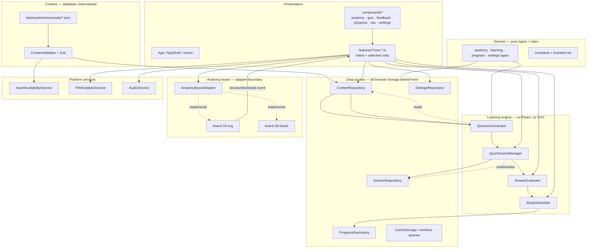

# Phase 0 — Technical Architecture

Status: complete, awaiting approval
Scope: frontend and PWA architecture for Muscle Atlas v1

---

## 1. Stack decision

| Concern | Choice | Why this and not the alternative |
| --- | --- | --- |
| Language | TypeScript, `strict: true`, `noUncheckedIndexedAccess` | The brief mandates strong typing; `noUncheckedIndexedAccess` catches real index bugs in content-driven code |
| UI runtime | React 19 | Mandated; mature, and the thin-component discipline is achievable |
| Build | Vite 7 | Fast dev loop, native ESM, first-class PWA plugin ecosystem |
| Styling | CSS Modules + CSS custom property tokens | Chosen over Tailwind deliberately: this product is a designed instrument, and deliberate whitespace and hierarchy are explicit requirements. Utility-class markup obscures layout intent in review |
| Routing | `react-router` v7 (declarative mode) | Route-level code splitting is required by the performance budget |
| Validation | Zod v4 | Mandated; the content pack and all persisted data are external boundaries |
| Persistence | Dexie v4 | Small, typed, migration-aware IndexedDB wrapper |
| UI/session state | Zustand | Explicitly scoped to ephemeral UI state only. Learning state lives in services |
| Offline | `vite-plugin-pwa` (Workbox `generateSW`) | Mandated-compatible; versioned precache with a runtime cache for content packs |
| Testing | Vitest + Testing Library + jsdom; Playwright for E2E | Mandated set; same runner for unit and integration keeps the loop tight |
| Rendering | SVG 2D, hand-authored paths, no canvas | Mandated; see §5 |

Explicit non-dependencies in v1: no 3D engine, no canvas layer, no backend, no auth, no
analytics, no AI runtime, no state-management-heavy data layer, no CSS framework runtime.

---

## 2. Dependency rule (the one that matters)

```
data ──> repositories ──> learning services ──> hooks/use-cases ──> components ──> DOM
                                   ▲
                            board adapters
```

Hard rules:

1. `src/domain/**` imports nothing from `src/components`, `src/features`, or React.
2. Learning services never import a React component, a board renderer, or a CSS file.
3. Components render state and forward intent. They never decide correctness, never read
   JSON, and never build a question pool.
4. The quiz engine learns nothing about the input surface. It receives a `structureId` and
   an outcome. It does not know whether that came from SVG, a future canvas, a future 3D
   mesh collider, a keyboard list, or a label.
5. All cross-cutting constants live in `src/domain/**/constants.ts` or
   `src/config/*.ts`. No magic strings or numbers in components.
6. Nothing in `src/domain` or `src/features/learning` may contain a muscle name.

Rule 6 is the structural guard against building muscular-specific software. If a future
skeletal system needs a different question type, only `src/data/systems/**` and content
validation change.

---

## 3. Architecture diagram



---

## 4. Exact directory tree

```
muscle-atlas/
├── README.md
├── index.html
├── package.json
├── tsconfig.json
├── tsconfig.node.json
├── vite.config.ts
├── vitest.config.ts
├── playwright.config.ts
├── .env.example
├── .gitignore
│
├── public/
│   ├── manifest.webmanifest
│   ├── offline.html
│   ├── icons/
│   │   ├── icon-180.png
│   │   ├── icon-192.png
│   │   ├── icon-512.png
│   │   ├── icon-1024.png
│   │   └── maskable-512.png
│   └── content-manifest.json          # static, versioned — see design brief C4
│
├── docs/
│   ├── 00-design-brief.md
│   ├── 01-architecture.md
│   ├── 02-domain-model-and-schemas.md
│   ├── 03-anatomy-board.md
│   ├── 04-asset-pipeline-and-licensing.md
│   ├── 05-content-review-workflow.md
│   ├── ipad-safari-test-plan.md
│   ├── 07-mvp-acceptance.md
│   └── 08-phase1-tasks.md
│
└── src/
    ├── main.tsx
    │
    ├── app/
    │   ├── App.tsx
    │   ├── AppShell.tsx
    │   ├── routes.tsx
    │   ├── providers/
    │   │   ├── RepositoryProvider.tsx
    │   │   ├── SettingsProvider.tsx
    │   │   ├── ContentGateProvider.tsx
    │   │   └── UpdateProvider.tsx
    │   └── ErrorBoundary.tsx
    │
    ├── components/
    │   ├── anatomy/
    │   │   ├── AnatomyBoard.tsx            # viewport + renderer host
    │   │   ├── ViewSwitcher.tsx
    │   │   ├── ViewportControls.tsx
    │   │   ├── StructureLabels.tsx
    │   │   └── BoardLoadingState.tsx
    │   ├── quiz/
    │   │   ├── PromptBar.tsx
    │   │   ├── RoundSetupForm.tsx
    │   │   ├── HintControls.tsx
    │   │   ├── FeedbackPanel.tsx
    │   │   ├── FeedbackSheet.tsx
    │   │   ├── ResultsView.tsx
    │   │   └── RoundProgress.tsx
    │   ├── feedback/
    │   │   ├── OutcomeBadge.tsx            # colour + icon + text, never colour alone
    │   │   └── ReviewReasonList.tsx
    │   ├── progress/
    │   │   ├── ProgressSummary.tsx
    │   │   ├── StructureMasteryBar.tsx
    │   │   └── ReviewQueueList.tsx
    │   ├── navigation/
    │   │   ├── AppBar.tsx
    │   │   ├── PrimaryNav.tsx
    │   │   └── Drawer.tsx
    │   ├── settings/
    │   │   ├── SettingsView.tsx
    │   │   ├── StorageSection.tsx
    │   │   ├── CreditsView.tsx
    │   │   └── InstallInstructions.tsx
    │   └── shared/
    │       ├── Button.tsx
    │       ├── IconButton.tsx
    │       ├── VisuallyHidden.tsx
    │       ├── LiveRegion.tsx
    │       ├── Drawer.tsx
    │       ├── Sheet.tsx
    │       ├── FocusTrap.tsx
    │       ├── Modal.tsx
    │       └── SearchField.tsx
    │
    ├── features/
    │   ├── anatomy-board/
    │   │   ├── contracts/
    │   │   │   └── anatomy-board-adapter.ts   # Phase 0 deliverable, type-only
    │   │   ├── board-2d-svg/
    │   │   │   ├── SvgAnatomyBoard.tsx
    │   │   │   ├── muscle-paths.data.ts       # structure_id -> path/mapping import
    │   │   │   ├── viewport/
    │   │   │   │   ├── useViewport.ts
    │   │   │   │   └── ViewportTransform.tsx
    │   │   │   └── selection/
    │   │   │       ├── usePointerSelection.ts
    │   │   │       └── resolveCandidate.ts
    │   │   ├── board-3d-future/
    │   │   │   └── README.md                   # design notes only, no code
    │   │   └── debug/
    │   │       ├── DebugLayer.tsx
    │   │       └── debug-store.ts
    │   ├── content/
    │   │   ├── schemas/
    │   │   │   ├── anatomy-system.ts
    │   │   │   ├── structure.ts
    │   │   │   ├── visual-mapping.ts
    │   │   │   ├── question-template.ts
    │   │   │   ├── source-reference.ts
    │   │   │   ├── asset-manifest.ts
    │   │   │   └── progress.ts
    │   │   ├── validation/
    │   │   │   ├── ContentValidator.ts
    │   │   │   └── rules.ts
    │   │   └── repository/
    │   │       ├── ContentRepository.ts
    │   │       └── StaticContentRepository.ts
    │   ├── learning/
    │   │   ├── question-generator/
    │   │   │   ├── QuestionGenerator.ts
    │   │   │   ├── EligibilityFilter.ts
    │   │   │   └── PoolBuilder.ts
    │   │   ├── answer-evaluator/
    │   │   │   ├── AnswerEvaluator.ts
    │   │   │   └── OutcomePolicy.ts
    │   │   ├── study-scheduler/
    │   │   │   ├── StudyScheduler.ts
    │   │   │   └── ReviewPriority.ts
    │   │   └── session/
    │   │       ├── QuizSessionManager.ts
    │   │       └── SessionState.ts
    │   ├── progress/
    │   │   ├── repositories/
    │   │   │   ├── ProgressRepository.ts
    │   │   │   ├── SessionRepository.ts
    │   │   │   └── SettingsRepository.ts
    │   │   └── calculations/
    │   │       ├── AccuracyCalculator.ts
    │   │       └── MasteryCalculator.ts
    │   ├── pwa/
    │   │   ├── offline/
    │   │   │   ├── AssetAvailabilityService.ts
    │   │   │   └── offline-store.ts
    │   │   └── updates/
    │   │       └── PWAUpdateService.ts
    │   └── accessibility/
    │       ├── useFocusTrap.ts
    │       ├── useLiveAnnouncement.ts
    │       ├── useReducedMotion.ts
    │       └── shortcuts.ts
    │
    ├── domain/
    │   ├── anatomy/
    │   │   ├── ids.ts                 # branded StructureId, VisualId, ViewId, LayerId, RegionId
    │   │   ├── anatomy-system.ts
    │   │   ├── anatomy-structure.ts
    │   │   ├── visual-mapping.ts
    │   │   ├── region.ts
    │   │   └── view.ts
    │   ├── learning/
    │   │   ├── question.ts
    │   │   ├── question-template.ts
    │   │   ├── answer-outcome.ts
    │   │   ├── hint.ts
    │   │   └── quiz-session.ts
    │   ├── progress/
    │   │   ├── study-progress.ts
    │   │   ├── mastery.ts
    │   │   └── review.ts
    │   ├── settings/
    │   │   └── user-settings.ts
    │   └── content/
    │       ├── source-reference.ts
    │       ├── asset-manifest-entry.ts
    │       ├── content-pack-manifest.ts
    │       └── content-status.ts
    │
    ├── config/
    │   ├── app-config.ts
    │   ├── learning-config.ts
    │   ├── storage-config.ts
    │   └── build-flags.ts
    │
    ├── services/
    │   ├── storage/
    │   │   ├── db.ts
    │   │   ├── migrations.ts
    │   │   └── corrupted-store-recovery.ts
    │   ├── audio/
    │   │   └── AudioService.ts
    │   └── telemetry-future/
    │       └── README.md
    │
    ├── styles/
    │   ├── tokens.css
    │   ├── globals.css
    │   ├── themes.css
    │   └── motion.css
    │
    ├── assets/
    │   ├── anatomy/muscular/
    │   │   ├── anterior/
    │   │   │   ├── anterior-base.svg           # body silhouette, non-interactive
    │   │   │   ├── anterior-muscles.svg        # one <g> per structure, selectable
    │   │   │   └── anterior-labels.svg
    │   │   └── posterior/
    │   │       ├── posterior-base.svg
    │   │       ├── posterior-muscles.svg
    │   │       └── posterior-labels.svg
    │   ├── icons/
    │   ├── audio/
    │   └── fonts/
    │
    └── test/
        ├── setup/
        │   ├── vitest.setup.ts
        │   └── fake-indexeddb.ts
        ├── unit/
        │   ├── ContentValidator.spec.ts
        │   ├── QuestionGenerator.spec.ts
        │   ├── AnswerEvaluator.spec.ts
        │   ├── StudyScheduler.spec.ts
        │   ├── MasteryCalculator.spec.ts
        │   └── Persistence.spec.ts
        ├── integration/
        │   ├── QuizSessionFlow.spec.tsx
        │   ├── SvgSelection.spec.tsx
        │   ├── TapVsPan.spec.tsx
        │   ├── HintRevealSkip.spec.tsx
        │   └── UpdateDeferral.spec.ts
        ├── fixtures/
        │   └── content.fixture.ts
        └── e2e/
            ├── identify-round.spec.ts
            ├── explore.spec.ts
            ├── resume-session.spec.ts
            ├── keyboard-navigation.spec.ts
            └── progress-reset.spec.ts
```

### Deviations from the brief's tree, and why

| Deviation | Reason |
| --- | --- |
| `features/anatomy-board/selection/resolveCandidate.ts` split out | Multi-candidate hit resolution (design brief C3) is genuinely complex and must be unit-testable in isolation |
| `features/anatomy-board/viewport/` added | Pan/zoom/reset state is not render concern; keeping it separate makes the pointer logic testable without a DOM |
| `features/content/repository/` (not just a `repository/`) | Content and browser storage are different concerns; content is static and validated, storage is IndexedDB |
| `config/` added | Centralised constants, satisfying the no-magic-values rule without polluting domain |
| `test/fixtures/` and `test/setup/` added | Keeps tests readable and deterministic |
| `assets/anatomy/**` holds real SVG files rather than inline TSX | Required so art can be replaced by a designer without touching code, and so licensing is per-file |

---

## 5. Rendering architecture: why SVG, and how it is structured

### Layer order inside the SVG

```
<svg viewBox="0 0 1000 2200">
  <g data-layer="base">        body silhouette — pointer-events: none
  <g data-layer="muscle">      one <g id="muscular.anterior.biceps_brachii.surface"> per structure
  <g data-layer="hit">         forgiving hit strokes — pointer-events: stroke
  <g data-layer="state">       highlight fills driven by app state — pointer-events: none
  <g data-layer="labels">      optional text — pointer-events: none
  <g data-layer="debug">       dev only, build-time stripped
</svg>
```

- The pan/zoom transform is applied to a single wrapping `<g>` via a `transform` attribute,
  updated inside `requestAnimationFrame`. One transform, one composited layer.
- Structural state is expressed with `data-visual-state="correct|incorrect|selected|revealed|..."`.
  A single CSS file maps state to fill, stroke, and a dash pattern. **No scattered inline
  style mutation anywhere.** State is set by the app; CSS renders it.
- Every state that conveys meaning carries a non-colour cue: stroke-dasharray for revealed,
  a hatch pattern overlay for incorrect, a solid ring for selected, plus text in the
  feedback panel.

### Colour plus non-colour cues (accessibility requirement)

| State | Colour | Shape/texture | Text in panel |
| --- | --- | --- | --- |
| Selected | accent | solid 3 px ring | "You selected …" |
| Correct | green | solid 4 px ring + check icon | "Correct — …" |
| Incorrect | red | dashed 4 px ring + hatched overlay | "Not quite. You selected …" |
| Revealed | amber | dotted 4 px ring | "Revealed — …" |
| Assisted | blue | solid 2 px ring | "Correct with hint — …" |
| Dimmed | neutral | reduced opacity only | — |

---

## 6. Viewport model

```ts
interface ViewportState {
  readonly scale: number;        // 1 .. 6
  readonly tx: number;           // user units, viewBox space
  readonly ty: number;
  readonly mode: 'fit' | 'free' | 'focused';
}
```

- `fit` is the default and is recomputed on resize and orientation change.
- One-finger drag is only enabled when `scale > 1 || mode === 'free'`. Otherwise it does
  nothing, so it can never eat a selection tap.
- `focusStructure` animates `tx/ty/scale` to frame a structure's bounding box with padding,
  using transform+opacity-safe transition only.
- `resetViewport()` returns to `fit` and is bound to a visible button plus `R`.
- Region isolate mode is `mode: 'focused'` with a region bounding box.

---

## 7. Persistence model

IndexedDB via Dexie, five stores:

| Store | Key | Purpose | Migration |
| --- | --- | --- | --- |
| `progress` | `structureId` | Per-structure study progress | `contentVersion` field; additive only |
| `sessions` | `sessionId` | Round history and per-item outcomes | Schema-versioned |
| `activeSession` | `'current'` | Exactly one in-flight round, for interruption recovery | Replaced wholesale per mutation |
| `settings` | `key` | User settings | Additive |
| `contentMeta` | `packId` | Cached content-pack version + availability | Additive |

Rules:

- Every read passes through Zod. A record that fails validation is quarantined, not trusted.
- `corrupted-store-recovery.ts` handles three cases: unknown schema version (migrate or
  discard with a message), corrupt record (discard record, keep the rest), unreadable store
  (offer reset with confirmation, never silently wipe).
- Writes for `activeSession` are debounced to 150 ms but **also** flushed synchronously on
  `visibilitychange` and `pagehide`.
- No DOM nodes, no React state objects, no functions. Plain JSON only.
- No personal identity data is stored. Profile id is a local random UUID, not an account.

---

## 8. PWA and offline architecture

### Cache layout

| Cache | Strategy | Contents |
| --- | --- | --- |
| `atlas-shell-<BUILD_ID>` | Precache (Workbox) | JS, CSS, HTML, icons, fonts, `offline.html` |
| `atlas-content-<PACK_VERSION>` | Precache | Muscular content pack JSON, anatomy SVGs |
| `atlas-assets-runtime-v1` | Cache-first | Fonts and icons fetched on demand |
| `atlas-images-runtime-v1` | Stale-while-revalidate | Runtime-loaded SVG/raster assets |

Precache entries carry a build-hashed filename, so a new build produces a new cache name and
the old one is cleaned up on `activate`. `content-pack.json` is `Cache-Control: no-cache` in
the network response path so an update is *discovered* but never applied mid-round.

### Update flow

```
SW detects new build
  → posts { type: 'WAITING' } to clients
  → PWAUpdateService stores waitingWorker, raises 'update-available'
  → UpdateProvider renders the banner:
        "A new version is ready. Reload after you finish this round."
  → Banner is non-blocking, non-modal, never steals focus
  → If a round is active, the reload button is disabled until the round ends
  → User taps reload → postMessage SKIP_WAITING → controlled reload
```

`skipWaiting` is **not** automatic. `clientsClaim` is disabled so an active tab is never
replaced underneath the learner. No `controllerchange`-triggered reload without explicit
user action.

### Offline behaviour

`AssetAvailabilityService.packState(packId)` returns
`{ status: 'cached' | 'missing' | 'partial', version, missing: AssetId[] }`.

- `cached` → play normally, no network indicator at all.
- `missing` → a single clear message: "This content pack needs one internet connection to
  download first." Never a generic error, never a spinner.
- `partial` → blocked with the specific missing assets named.

An offline badge appears only when it is actionable: never for cached content, never during
a round, never over the board.

---

## 9. Performance budget

Targets on iPad Air M4, Safari, typical school connection:

| Metric | Budget |
| --- | --- |
| First contentful paint (app shell) | < 900 ms on Wi-Fi |
| Time to interactive anatomy board | < 1.8 s |
| Transfer for first route | < 220 KB gzip, excluding lazily loaded routes |
| Interaction to visual feedback | < 100 ms |
| Pan/zoom frame budget | < 16 ms; transform-only updates |
| Heap after 20 questions | flat within 5% of start |
| Long tasks during a round | zero > 50 ms |

Enforcement:

- Route-level `React.lazy` for Progress, Settings, Credits, and any future 3D route.
- The muscular pack is the only content pack bundled or precached. Other systems ship as
  separate versioned packs fetched on demand — never preloaded.
- `content-visibility: auto` on long reference lists.
- Animations restricted to `transform` and `opacity`. No filter animation, no
  `backdrop-filter` in hot paths, no box-shadow animation, no rAF loop running when idle.
- No canvas redraw loop in v1.
- Non-essential animation paused via `visibilitychange` and `prefers-reduced-motion`.
- SVG optimisation must preserve `id`, `data-structure-id`, and `data-visual-id`
  attributes — enforced by a test, not by convention.

---

## 10. Test strategy

| Layer | Tool | Covers |
| --- | --- | --- |
| Unit | Vitest | schemas, validator, eligibility, generator, evaluator, scheduler, mastery, persistence, migrations, offline availability, candidate resolution |
| Integration | Vitest + Testing Library | quiz flow, feedback states, hint/reveal/skip, SVG selection events, tap vs pan, session persistence, results, responsive mode change, update deferral |
| E2E | Playwright | full round completion, correct + incorrect selection, resume after reload, explore mode, keyboard-only navigation, progress reset |
| Manual | iPad Air M4 | the full matrix in `ipad-safari-test-plan.md` |

Playwright's WebKit engine approximates Safari but **is not Safari on iPadOS**. Desktop
emulation is not a substitute for the manual pass. That distinction is recorded in the test
plan and on the acceptance checklist.

---

## 11. Build flags

`src/config/build-flags.ts`:

| Flag | Default | Purpose |
| --- | --- | --- |
| `ALLOW_DRAFT_CONTENT` | `true` in dev, `false` in prod | Release builds cannot load draft structures at all |
| `PROVISIONAL_ART` | `true` until real art lands | Draws a persistent "provisional illustration" notice |
| `ENABLE_DEBUG_TOOLS` | dev only | Debug layer and console; stripped from production bundles |
| `ENABLE_TIMED_CHALLENGE` | `false` | Ships off; hidden until reviewed |

`PROVISIONAL_ART` and `ALLOW_DRAFT_CONTENT` both block a release build if still enabled,
enforced in `vite.config.ts` so the failure happens at build time rather than in review.

---

## 12. Accessibility architecture

- Semantic elements throughout; `role` only where native semantics are insufficient.
- The board exposes an accessible alternative: every published structure is reachable via a
  keyboard-navigable list of buttons in Explore mode and a combobox in Identify mode, so the
  learning flow never requires spatial targeting. This is a functional requirement, not a
  nicety — and it is also the cleanest way to satisfy design brief C3.
- `aria-live="polite"` for progress, `aria-live="assertive"` reserved for the question prompt
  and answer outcome.
- Focus is trapped only inside modal surfaces, and restored to the invoking element on close.
- `prefers-reduced-motion` removes viewport animation and transitions.
- All interactive targets ≥ 44 px; visual state never relies on colour.
- Font sizing in `rem`; layout containers use `min()`/`clamp()` and logical properties so
  increased text size reflows instead of clipping.

---

## 13. Phase boundary

Delivered in Phase 0, as type-only artifacts:

- `src/features/anatomy-board/contracts/anatomy-board-adapter.ts`

Everything else in the tree above is **specified but not written**. Phase 1 creates the
project, shell, tokens, routing, manifest, service worker foundation, and storage foundation
— and deliberately contains no anatomy or quiz logic.
